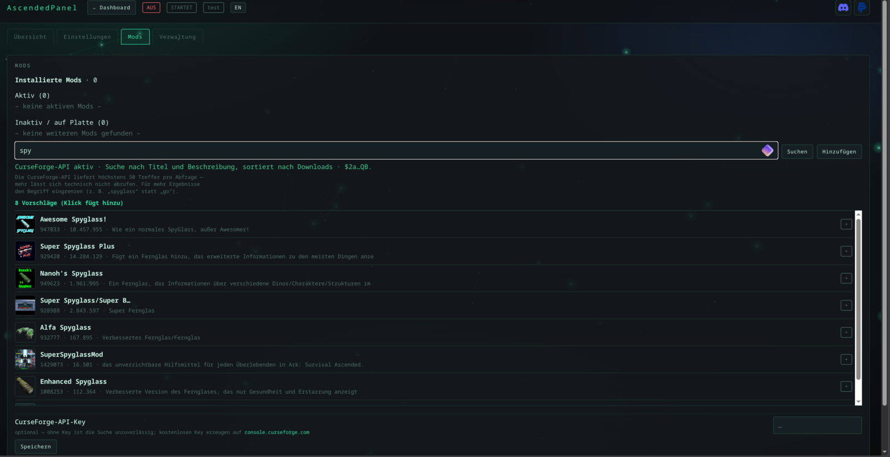

# AscendedPanel — ARK: Survival Ascended Servermanager für Linux · Web-UI im Browser

[Deutsch](README.de.md) · [English](README.md) — der Installer fragt beim Start nach der Sprache, die Oberfläche lässt sich
jederzeit umschalten (Knopf oben rechts, `ascendedpanel lang en` in der Konsole).

[](https://www.paypal.com/donate/?business=ronnyhase%40fn.de&item_name=AscendedPanel%20Servermanager&currency_code=EUR)
[](https://discord.gg/ark-ase-asa-hilfe)

[](#installation)
[](#installation)
[](#installation)
[](#installation)
[](#installation)

**[Installation](#installation)** · [Deinstallation](#deinstallieren) · [Funktionen](docs/funktionen.md) · [Zugriff](docs/zugriff.md) · [Betrieb](docs/betrieb.md) · [Technik](docs/technik.md)

Ein eigener Servermanager für ARK-ASA-Dedicated-Server: Start, Stop, Updates, Mods, Backups,
Einstellungen und Spielerverwaltung über eine Weboberfläche.

> **Keine App für deinen PC — kein Windows- oder macOS-Programm.** ascendedpanel läuft als Dienst auf dem
> Linux-Server und wird im **Browser** bedient: vom PC, Notebook, Tablet oder Handy, im Heimnetz oder
> über VPN. Auf dem Server installierst du es **einmal** (`install.sh`, `git clone`); danach gibt es
> nichts mehr herunterzuladen und kein Programm zu starten — nur die Adresse mit Token.

Reines Python (nur Standardbibliothek), SteamCMD für Installation und Updates, Wine für den
Serverprozess, RCON für alles, was der Server von außen anbietet.


## Einblicke

| | |
|:--:|:--:|
|  |  |
|  |  |



Mehr dazu: [docs/funktionen.md](docs/funktionen.md)

## Installation

```bash
git clone https://github.com/Ronny-H-79/AscendedPanel.git ascendedpanel   # einmalig
cd ascendedpanel
./install.sh --check     # prüfen, was fehlt (ändert nichts)
./install.sh             # installieren
ascendedpanel url                 # Adresse mit Token - der Web-Dienst laeuft bereits
```

Instanzen legst du **im Browser** an: ausgegebene Adresse öffnen, Namen eintragen, Karte wählen,
**Anlegen** drücken, dann **Installieren** auf der Karte. Danach braucht es kein Terminal mehr.

**Nur Konsole, optional:** `ascendedpanel wizard` ist die Terminal-Alternative — fragt Name, Karte, Port und
Session-Namen ab, lädt die Serverdateien und richtet den systemd-Dienst ein. Er braucht eine
interaktive Sitzung und ist **nicht** nötig: alles geht auch in der Web-Oberfläche.
`./install.sh --wizard` startet ihn direkt nach der Installation.

**Voraussetzungen:** Linux, Python ≥ 3.10, Wine, `curl` und `tar`. Fehlende Pakete fragt der Installer
und installiert sie auf Wunsch (`pacman`, `apt`, `dnf`, `zypper`). SteamCMD lädt er selbst nach,
root-Rechte braucht nur das Nachinstallieren von Wine.

**Wo es getestet ist** — Stand 8. November 2026, jeweils mit laufendem ARK-ASA-Server:

| System | Version | Umgebung |
|---|---|---|
| Ubuntu LTS | 24.04.5 | Python 3.12.3, Wine 9.0 |
| Arch Linux (CachyOS) | aktuell | Python 3.14.9, Wine 11.21 |

Debian, Fedora und openSUSE unterstützt der Installer ebenfalls (`apt`, `dnf`, `zypper`), dort ist
ascendedpanel aber noch nicht durchgetestet — Rückmeldung willkommen. Nötig ist 64-Bit-Wine (für den
Windows-Server von ARK); ältere Wine-Stände unter 8.0 sind nicht getestet.

Prüfen, was die eigene Kiste hat:

```bash
. /etc/os-release && echo "$PRETTY_NAME"; python3 --version; wine --version
```

Der Installer stellt nacheinander:

- **Sprache** (Deutsch/Englisch)
- ob fehlende Pakete (**Wine**, iproute2) nachinstalliert werden sollen
- **wie die Oberfläche erreichbar sein soll:**
  **Tunnel** — nur client-seitig über SSH,
  **Domain** — öffentlich mit HTTPS (wird gleich mitgespeichert),
  **IP** — direkt über IP und Port (HTTP, Port in der Firewall freigeben)
- **nur bei „Domain"**: ob die Web-Oberfläche dauerhaft laufen soll (`ascendedpanel-web.service`) — als root ein
  **Systemdienst** in `/etc/systemd/system` (startet beim Booten, kein Login und kein `linger` nötig),
  als normaler Benutzer ein User-Dienst in `~/.config/systemd/user`

Bei **„Tunnel"** entfällt die letzte Frage: dafür braucht es keinen Dauerdienst, die Oberfläche wird
mit `ascendedpanel web` gestartet, wenn du sie brauchst.

Am Ende steht genau der Befehl, der zu deiner Wahl passt: der SSH-Tunnel mit deinem Benutzer und der
**IP des Servers** (nicht dem Hostnamen — der ist von außen oft nicht auflösbar), oder
`sudo ascendedpanel proxy --write --cert`, das die gespeicherte Domain automatisch verwendet.
`--web` / `--no-web` überspringt die Dienst-Frage.

> **Sicherheit:** Die Oberfläche ist eine Administrationskonsole — wer den Token hat, kann alles
> steuern. Modus `[3]` (direkt über IP) ist **unverschlüsselt**, der Token ist dort mitlesbar. Nimm
> `[1]` (SSH-Tunnel) oder `[2]` (HTTPS). Details: [docs/zugriff.md](docs/zugriff.md#sicherheit--was-der-token-bedeutet)

### Wenn die Installation hakt

| Meldung | Ursache | Lösung |
|---|---|---|
| `fatal: destination path 'AscendedPanel' already exists` | der Ordner liegt schon da | `cd ascendedpanel && git pull` statt erneut klonen |
| `./install.sh: No such file or directory` **nach** `cd ascendedpanel/ascendedpanel` | du stehst im Paketordner `AscendedPanel/AscendedPanel` — dort liegen nur `.py`-Dateien | `cd ..` — `install.sh` liegt eine Ebene höher, im Projektordner |
| `AscendedPanel: command not found` | `~/.local/bin` ist nicht im `PATH` | als root legt der Installer `/usr/local/bin/ascendedpanel` an; sonst `export PATH="$HOME/.local/bin:$PATH"` und neue Shell öffnen |

**Eine Falle bei Namensgleichheit:** im Projektordner heißt der Python-Teil ebenfalls `ascendedpanel`.
`cd ascendedpanel/ascendedpanel` führt dich also ein zweites Mal hinein — dort liegen `cli.py`, `i18n.py` und Co., aber kein
`install.sh`. Merksatz: der richtige Ordner ist der mit `install.sh`, `README.md` und `docs/`.

Als **root** auf einem Server: alle Befehle in einer Sitzung hintereinander ausführen, sonst landet
man schnell im falschen Verzeichnis. Und für `systemctl --user` (Autostart) einmalig
`loginctl enable-linger root` — sonst startet der Dienst erst beim Login.

Details, Voraussetzungen und Deinstallation: [INSTALL.md](INSTALL.de.md)

## Deinstallieren

**Nur das Programm** (Instanzen, Backups und Einstellungen bleiben):

```bash
cd ~/ascendedpanel      # in den Klon des Repos wechseln
./install.sh --uninstall
```

Das beendet und entfernt auch die systemd-Dienste (`ascendedpanel-web`, `ascendedpanel-*`), damit nach dem Löschen
kein Dienst mehr ins Leere zeigt. Ist der Quellordner schon weg, reicht von Hand:

```bash
# Installation als root (Systemdienst) - der Normalfall auf einem Server
systemctl disable --now ascendedpanel-web.service
rm -f /etc/systemd/system/ascendedpanel-*.service /usr/local/bin/ascendedpanel
rm -rf /root/.local/share/ascendedpanel

# nur bei Installation als normaler Nutzer: dafuer muss eine Sitzung des Nutzers
# laufen, sonst bricht systemctl --user ab ("DBUS_SESSION_BUS_ADDRESS not defined")
systemctl --user disable --now ascendedpanel-web.service
rm -f ~/.config/systemd/user/ascendedpanel-*.service ~/.local/bin/ascendedpanel
rm -rf ~/.local/share/ascendedpanel
```

**Alles weg** — zusätzlich Konfiguration, Token, Sicherungen und Serverdaten (zusammen etwa 24 GB):

```bash
rm -rf ~/.config/ascendedpanel          # Instanzen, Token, Mod-Cache
rm -rf ~/ascendedpanel-backups          # Welt-Backups
rm -rf ~/ascendedpanel-snapshots        # Instanz-Snapshots
rm -rf ~/arkserver             # die Serverdateien (12 GB)
rm -rf ~/.wine-arkserver       # Wine-Prefix
```

Der letzte Schritt ist der einzige, der wirklich unwiederbringlich ist: Welt und Configs liegen in
`~/ascendedpanel-backups` — wer die behält, kann später alles wieder herstellen.

**SteamCMD** (`~/steamcmd`, `~/.steam`, `~/Steam`) wird von `--uninstall` ebenfalls entfernt.

### Alles entfernen (auch Instanzen und Welten)

```bash
cd ~/ascendedpanel      # in den Klon des Repos wechseln
./install.sh --uninstall
rm -rf ~/arkserver-* ~/.config/ascendedpanel ~/ascendedpanel-backups ~/ascendedpanel-snapshots
rm -f /etc/systemd/system/ascendedpanel-*.service
systemctl daemon-reload
```

Was wo liegt: Programm `~/.local/share/ascendedpanel` und `~/.local/bin/ascendedpanel`, Einstellungen und
Token `~/.config/ascendedpanel`, Instanzen mit Welten `~/arkserver-<name>`, SteamCMD `~/steamcmd`,
`~/.steam` und `~/Steam`.

## Mehr

| Thema | Datei |
|---|---|
| **Funktionen** — Übersicht, Screenshots, Mod-Suche, Discord-Meldungen | [docs/funktionen.md](docs/funktionen.md) |
| **Zugriff** — SSH-Tunnel, LAN, HTTPS per nginx, Token | [docs/zugriff.md](docs/zugriff.md) |
| **Betrieb** — Selbst-Update, Changelog, Sprache | [docs/betrieb.md](docs/betrieb.md) |
| **Technik** — Aufbau, Konsole, Stop-Reihenfolge, Interna | [docs/technik.md](docs/technik.md) |

Was sich zwischen Versionen geändert hat: [CHANGELOG.md](CHANGELOG.md) ·
Installationsdetails: [INSTALL.md](INSTALL.de.md)

## Hilfe

Fragen, Probleme oder einfach andere Serverbetreiber: die Community
**[Ark-ASA-ASE-Hilfe](https://discord.gg/ark-ase-asa-hilfe)** auf Discord hilft bei Einstellungen,
Mods und Startproblemen. Dort bekommst du auch Rueckmeldung zu AscendedPanel.

## Lizenz

**Kostenlos nutzbar, alle Rechte beim Autor.** Herunterladen, installieren und auf eigenen
Servern betreiben ist frei — auch für eine Community. Weitergabe, Veränderung, Verkauf oder
das Anbieten als Download/Dienst brauchen eine schriftliche Zustimmung.
Details: [LICENSE](LICENSE).

© 2026 Ronny H.
