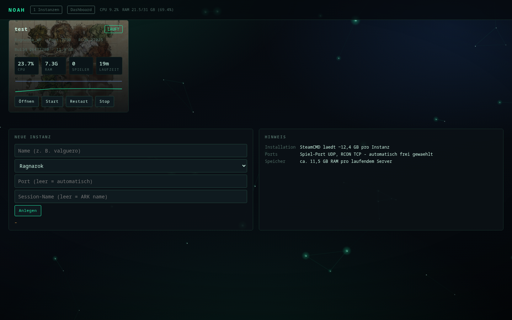
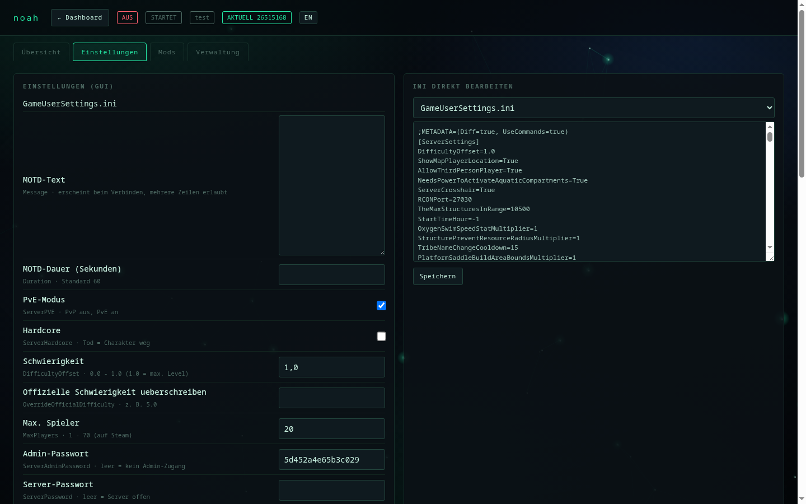
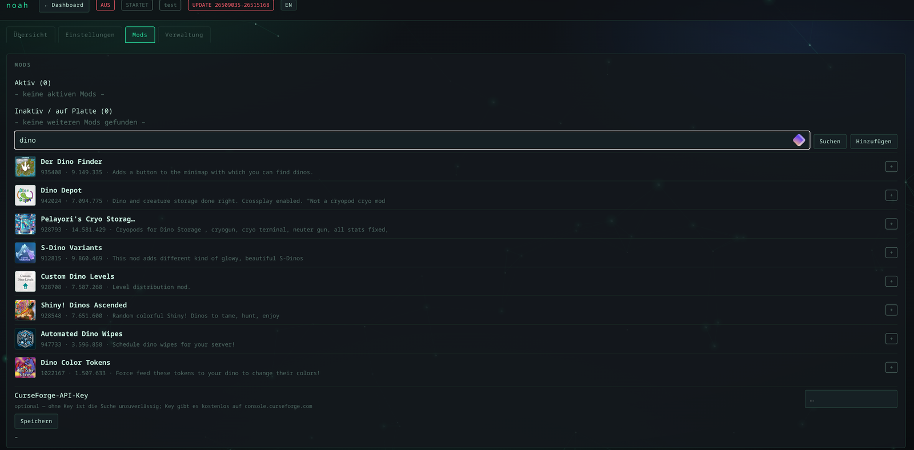
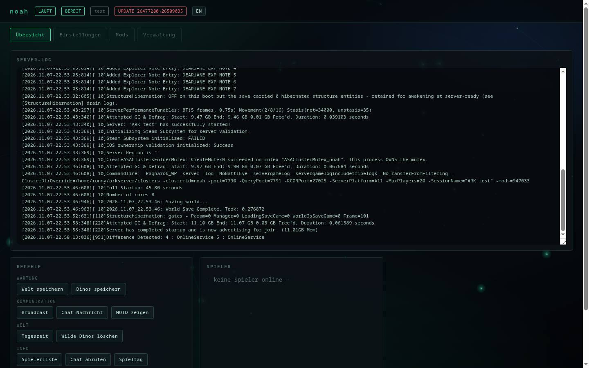
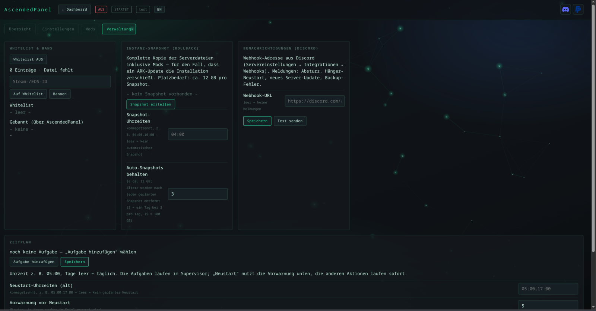

# noah — ARK: Survival Ascended Servermanager für Linux

[Deutsch](README.de.md) · [English](README.md) — der Installer fragt beim Start nach der Sprache, die Oberfläche lässt sich
jederzeit umschalten (Knopf oben rechts, `noah lang en` in der Konsole).

[](https://www.paypal.com/donate/?business=ronnyhase%40fn.de&item_name=noah%20Servermanager&currency_code=EUR)

**[Installation](#installation)** · [Deinstallation](#deinstallieren) · [Funktionen](docs/funktionen.md) · [Zugriff](docs/zugriff.md) · [Betrieb](docs/betrieb.md) · [Technik](docs/technik.md)

Ein eigener Servermanager für ARK-ASA-Dedicated-Server: Start, Stop, Updates, Mods, Backups,
Einstellungen und Spielerverwaltung über eine Weboberfläche.

Reines Python (nur Standardbibliothek), SteamCMD für Installation und Updates, Wine für den
Serverprozess, RCON für alles, was der Server von außen anbietet.



## Einblicke

| | |
|:--:|:--:|
|  |  |
|  |  |

Mehr dazu: [docs/funktionen.md](docs/funktionen.md)

## Installation

```bash
git clone https://github.com/Ronny-H-79/Noah.git noah   # einmalig
cd noah
./install.sh --check     # prüfen, was fehlt (ändert nichts)
./install.sh             # installieren
noah wizard              # Instanz anlegen, Server laden, Dienst einrichten
```

**Voraussetzungen:** Linux, Python ≥ 3.10, Wine, `curl` und `tar`. Fehlende Pakete fragt der Installer
und installiert sie auf Wunsch (`pacman`, `apt`, `dnf`, `zypper`). SteamCMD lädt er selbst nach,
root-Rechte braucht nur das Nachinstallieren von Wine.

Der Installer stellt nacheinander:

- **Sprache** (Deutsch/Englisch)
- ob fehlende Pakete (**Wine**, iproute2) nachinstalliert werden sollen
- **wie die Oberfläche erreichbar sein soll:**
  **Tunnel** — nur client-seitig über SSH,
  **Domain** — öffentlich mit HTTPS (wird gleich mitgespeichert),
  **IP** — direkt über IP und Port (HTTP, Port in der Firewall freigeben)
- **nur bei „Domain"**: ob die Web-Oberfläche dauerhaft laufen soll (`noah-web.service`) — als root ein
  **Systemdienst** in `/etc/systemd/system` (startet beim Booten, kein Login und kein `linger` nötig),
  als normaler Benutzer ein User-Dienst in `~/.config/systemd/user`

Bei **„Tunnel"** entfällt die letzte Frage: dafür braucht es keinen Dauerdienst, die Oberfläche wird
mit `noah web` gestartet, wenn du sie brauchst.

Am Ende steht genau der Befehl, der zu deiner Wahl passt: der SSH-Tunnel mit deinem Benutzer und der
**IP des Servers** (nicht dem Hostnamen — der ist von außen oft nicht auflösbar), oder
`sudo noah proxy --write --cert`, das die gespeicherte Domain automatisch verwendet.
`--web` / `--no-web` überspringt die Dienst-Frage.

> **Sicherheit:** Die Oberfläche ist eine Administrationskonsole — wer den Token hat, kann alles
> steuern. Modus `[3]` (direkt über IP) ist **unverschlüsselt**, der Token ist dort mitlesbar. Nimm
> `[1]` (SSH-Tunnel) oder `[2]` (HTTPS). Details: [docs/zugriff.md](docs/zugriff.md#sicherheit--was-der-token-bedeutet)

### Wenn die Installation hakt

| Meldung | Ursache | Lösung |
|---|---|---|
| `fatal: destination path 'noah' already exists` | der Ordner liegt schon da | `cd noah && git pull` statt erneut klonen |
| `./install.sh: No such file or directory` **nach** `cd noah` | du stehst im Paketordner `noah/noah` — dort liegen nur `.py`-Dateien | `cd ..` — `install.sh` liegt eine Ebene höher, im Projektordner |
| `noah: command not found` | `~/.local/bin` ist nicht im `PATH` | als root legt der Installer `/usr/local/bin/noah` an; sonst `export PATH="$HOME/.local/bin:$PATH"` und neue Shell öffnen |

**Eine Falle bei Namensgleichheit:** im Projektordner heißt der Python-Teil ebenfalls `noah`.
`cd noah` führt dich also ein zweites Mal hinein — dort liegen `cli.py`, `i18n.py` und Co., aber kein
`install.sh`. Merksatz: der richtige Ordner ist der mit `install.sh`, `README.md` und `docs/`.

Als **root** auf einem Server: alle Befehle in einer Sitzung hintereinander ausführen, sonst landet
man schnell im falschen Verzeichnis. Und für `systemctl --user` (Autostart) einmalig
`loginctl enable-linger root` — sonst startet der Dienst erst beim Login.

Details, Voraussetzungen und Deinstallation: [INSTALL.md](INSTALL.de.md)

## Deinstallieren

**Nur das Programm** (Instanzen, Backups und Einstellungen bleiben):

```bash
./install.sh --uninstall
```

Das beendet und entfernt auch die systemd-Dienste (`noah-web`, `noah-*`), damit nach dem Löschen
kein Dienst mehr ins Leere zeigt. Ist der Quellordner schon weg, reicht von Hand:

```bash
systemctl --user disable --now noah-web.service noah-test.service
rm -f ~/.config/systemd/user/noah-*.service ~/.local/bin/noah
rm -rf ~/.local/share/noah
```

**Alles weg** — zusätzlich Konfiguration, Token, Sicherungen und Serverdaten (zusammen etwa 24 GB):

```bash
rm -rf ~/.config/noah          # Instanzen, Token, Mod-Cache
rm -rf ~/noah-backups          # Welt-Backups
rm -rf ~/noah-snapshots        # Instanz-Snapshots
rm -rf ~/arkserver             # die Serverdateien (12 GB)
rm -rf ~/.wine-arkserver       # Wine-Prefix
```

Der letzte Schritt ist der einzige, der wirklich unwiederbringlich ist: Welt und Configs liegen in
`~/noah-backups` — wer die behält, kann später alles wieder herstellen.

## Mehr

| Thema | Datei |
|---|---|
| **Funktionen** — Übersicht, Screenshots, Mod-Suche, Discord-Meldungen | [docs/funktionen.md](docs/funktionen.md) |
| **Zugriff** — SSH-Tunnel, LAN, HTTPS per nginx, Token | [docs/zugriff.md](docs/zugriff.md) |
| **Betrieb** — Selbst-Update, Changelog, Sprache | [docs/betrieb.md](docs/betrieb.md) |
| **Technik** — Aufbau, Konsole, Stop-Reihenfolge, Interna | [docs/technik.md](docs/technik.md) |

Was sich zwischen Versionen geändert hat: [CHANGELOG.md](CHANGELOG.md) ·
Installationsdetails: [INSTALL.md](INSTALL.de.md)

## Lizenz

**Kostenlos nutzbar, alle Rechte beim Autor.** Herunterladen, installieren und auf eigenen
Servern betreiben ist frei — auch für eine Community. Weitergabe, Veränderung, Verkauf oder
das Anbieten als Download/Dienst brauchen eine schriftliche Zustimmung.
Details: [LICENSE](LICENSE).

© 2026 Ronny H.
