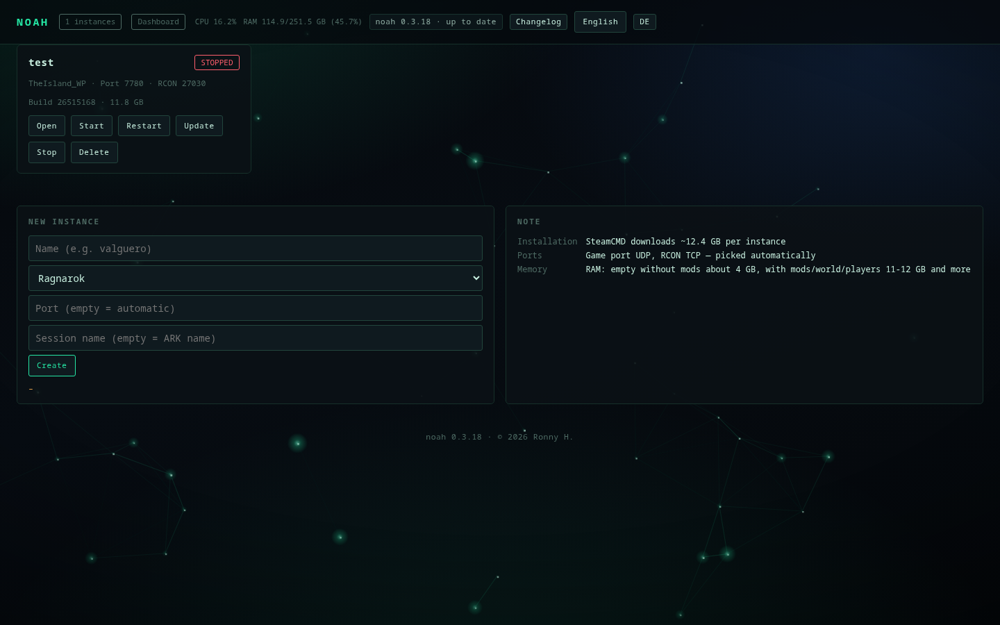
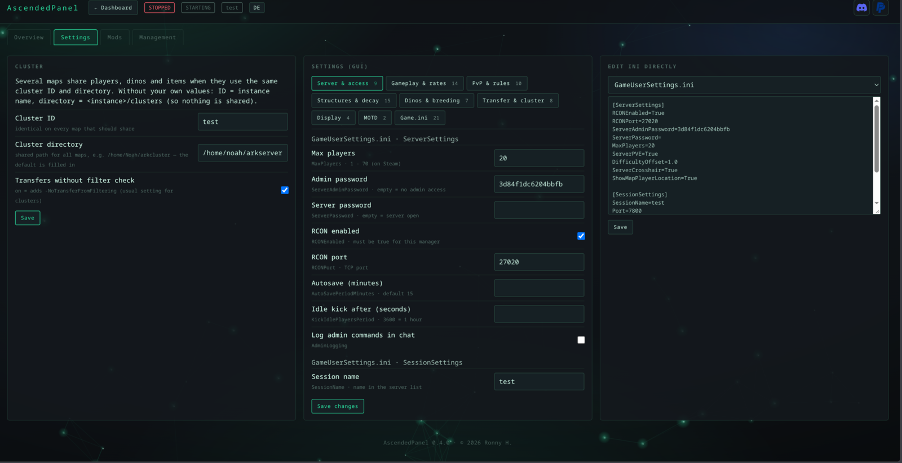
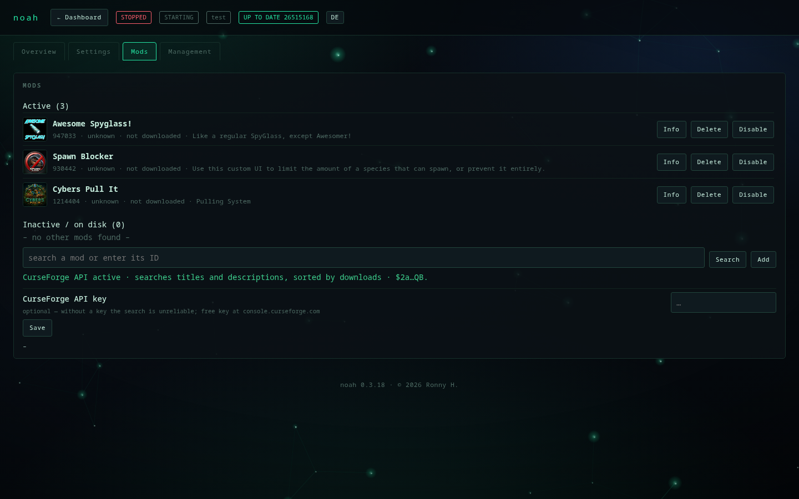
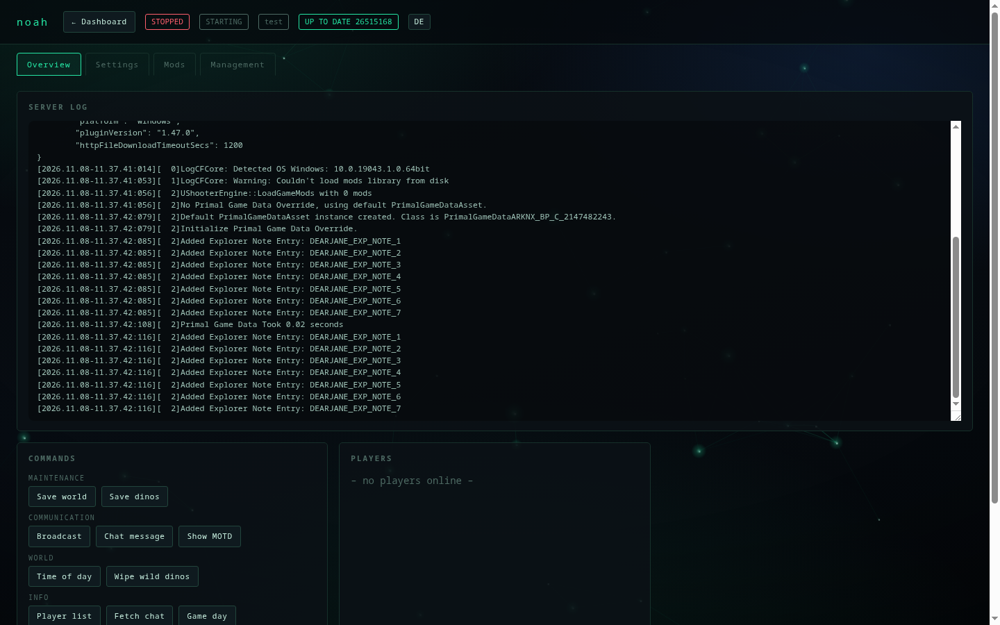
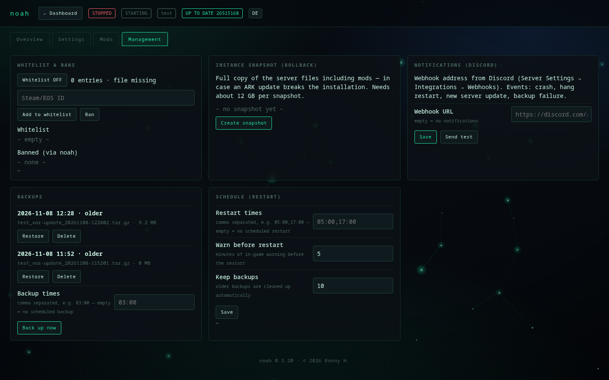
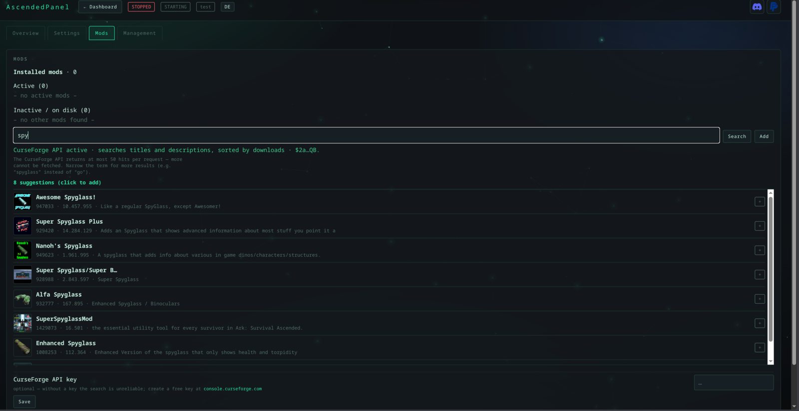

# AscendedPanel — ARK: Survival Ascended server manager for Linux · web UI in the browser

English · [Deutsch](README.de.md) — the installer asks for the language up front, and the UI can switch
any time (button in the top right, `ascendedpanel lang en` on the console).

[](https://www.paypal.com/donate/?business=ronnyhase%40fn.de&item_name=AscendedPanel%20Servermanager&currency_code=EUR)
[](https://discord.gg/ark-ase-asa-hilfe)

[](#installation)
[](#installation)
[](#installation)
[](#installation)
[](#installation)

**[Installation](#installation)** · [Uninstall](#uninstall) · [Features](docs/funktionen.md) · [Access](docs/zugriff.md)

Your own server manager for ARK ASA dedicated servers: start, stop, updates, mods, backups, settings
and player management through a web interface.

> **Not an app for your PC — no Windows or macOS program.** ascendedpanel runs as a service on the Linux
> server and is used in a **browser**: from your PC, laptop, tablet or phone, on your LAN or over VPN.
> You install it on the server **once** (`git clone`, `install.sh`); after that there is nothing to
> download and no program to launch — just the address with a token.

Plain Python (standard library only), SteamCMD for install and updates, Wine for the server process,
RCON for everything the server exposes.



## Screenshots

| | |
|:--:|:--:|
|  |  |
|  |  |



## Installation

```bash
git clone https://github.com/Ronny-H-79/AscendedPanel.git ascendedpanel   # once
cd ascendedpanel
./install.sh --check     # check what is missing (changes nothing)
./install.sh             # install (in your own user account, no sudo)
ascendedpanel web                 # start the web UI - the address with token is printed
```

Install without `sudo`: panel and servers then run as your user instead of root.

As **root** on a server (one line, no questions - creates the service user as well):

```bash
git clone https://github.com/Ronny-H-79/AscendedPanel.git ascendedpanel && cd ascendedpanel && ./install.sh --auto --lang de --web
```

Installs to `/home/ascendedpanel`, web service as user `ascendedpanel`, port 8790.

**Token forgotten or address lost?**

```bash
ascendedpanel token          # web token plus file path and address
ascendedpanel token --quiet  # only the token (for scripts)
ascendedpanel url            # ready-made address including the token
```

The token is also stored in `~/.config/ascendedpanel/token` (mode `600`).

Instances are created **in the browser**: open the printed address, enter a name, pick the map, press
**Anlegen / Create**, then **Install** on the card. No terminal is needed after that.

**Console only, optional:** `ascendedpanel wizard` is the terminal alternative — it asks for name, map, port
and session name, downloads the server files and sets up the systemd service. It needs an interactive
shell and is **not** required: everything the wizard does is also in the web UI. `./install.sh
--wizard` runs it right after installing.

**Requirements:** Linux, Python ≥ 3.10, Wine, `curl` and `tar`. Missing packages are offered by the
installer (`pacman`, `apt`, `dnf`, `zypper`). SteamCMD is downloaded automatically; root is only needed
to install Wine.

**Where it is tested** — as of 8 November 2026, each with a running ARK ASA server:

| System | Version | Environment |
|---|---|---|
| Ubuntu LTS | 24.04.5 | Python 3.12.3, Wine 9.0 |
| Arch Linux (CachyOS) | current | Python 3.14.9, Wine 11.21 |

Debian, Fedora and openSUSE are supported by the installer as well (`apt`, `dnf`, `zypper`), but AscendedPanel
has not been tested there yet — feedback welcome. 64-bit Wine is required (the ARK server is a Windows
build); Wine older than 8.0 is untested.

Check your own box:

```bash
. /etc/os-release && echo "$PRETTY_NAME"; python3 --version; wine --version
```

The installer asks, in order:

- **language** (German/English)
- whether missing packages (**Wine**, iproute2) should be installed
- **how the UI should be reachable:**
  **Tunnel** — client-side only over SSH,
  **Domain** — public with HTTPS (stored for later),
  **IP** — directly via IP and port (HTTP, open the port in your firewall)
- **only for "Domain"**: whether the UI should run permanently (`ascendedpanel-web.service`) — as root a
  **system service** in `/etc/systemd/system` (starts at boot, no login or `linger` needed), as a normal
  user a user service in `~/.config/systemd/user`

With **"Tunnel"** the last question is skipped: no long-running service is needed, the UI starts with
`ascendedpanel web` when you want it.

At the end you get the command that matches your choice: the SSH tunnel with your user and the
**server IP** (not the hostname — often not resolvable from outside), or
`sudo ascendedpanel proxy --write --cert`, which uses the stored domain.
`--web` / `--no-web` skips the service question.

> **Security:** the UI is an admin console — whoever has the token controls everything. Mode `[3]`
> (direct via IP) is **unencrypted** and the token can be read on the wire. Use `[1]` (SSH tunnel) or
> `[2]` (HTTPS). Details: [docs/zugriff.md](docs/zugriff.md).

### When the install gets stuck

| Message | Cause | Fix |
|---|---|---|
| `fatal: destination path 'AscendedPanel' already exists` | the folder is already there | `cd ascendedpanel && git pull` instead of cloning again |
| `./install.sh: No such file or directory` **after** `cd ascendedpanel/ascendedpanel` | you are in the package folder `AscendedPanel/AscendedPanel` — only `.py` files live there | `cd ..` — `install.sh` is one level up |
| `AscendedPanel: command not found` | `~/.local/bin` is not in `PATH` | as root the installer links `/usr/local/bin/ascendedpanel`; otherwise `export PATH="$HOME/.local/bin:$PATH"` and open a new shell |

Details, requirements and uninstall: [INSTALL.md](INSTALL.md)

## Uninstall

**The program only** (instances, backups and settings stay):

```bash
cd ~/ascendedpanel      # your clone of the repo
./install.sh --uninstall
```

This also stops and removes the systemd units (`ascendedpanel-web`, `ascendedpanel-*`) so nothing points at a missing
file afterwards. If the source folder is already gone:

```bash
# installation as root (system service) - the normal case on a server
systemctl disable --now ascendedpanel-web.service
rm -f /etc/systemd/system/ascendedpanel-*.service /usr/local/bin/ascendedpanel
rm -rf /root/.local/share/ascendedpanel

# only for a normal user installation: needs a running session of that user,
# otherwise systemctl --user fails ("DBUS_SESSION_BUS_ADDRESS not defined")
systemctl --user disable --now ascendedpanel-web.service
rm -f ~/.config/systemd/user/ascendedpanel-*.service ~/.local/bin/ascendedpanel
rm -rf ~/.local/share/ascendedpanel
```

**Everything** — additionally config, token, backups and server files (about 24 GB):

```bash
rm -rf ~/.config/ascendedpanel          # instances, token, mod cache
rm -rf ~/ascendedpanel-backups          # world backups
rm -rf ~/ascendedpanel-snapshots        # instance snapshots
rm -rf ~/arkserver             # the server files (12 GB)
rm -rf ~/.wine                 # Wine prefix (default; a path set on the instance is left alone)
```

Only the last step is irreversible: worlds and configs live in `~/ascendedpanel-backups` — keep those and you can
restore everything later.

**SteamCMD** (`~/steamcmd`, `~/.steam`, `~/Steam`) is removed by `--uninstall` as well.

### Remove everything (instances and worlds too)

```bash
cd ~/ascendedpanel      # your clone of the repo
./install.sh --uninstall
rm -rf ~/arkserver-* ~/.config/ascendedpanel ~/ascendedpanel-backups ~/ascendedpanel-snapshots
rm -rf ~/.wine                  # Wine prefix
rm -f /etc/systemd/system/ascendedpanel-*.service
systemctl daemon-reload
```

Where things live: program `~/.local/share/ascendedpanel` and `~/.local/bin/ascendedpanel`, settings and
token `~/.config/ascendedpanel`, instances with worlds `~/arkserver-<name>`, SteamCMD `~/steamcmd`,
`~/.steam` and `~/Steam`.

## More

| Topic | File |
|---|---|
| **Features** — overview, screenshots, mod search, Discord notifications | [docs/funktionen.md](docs/funktionen.md) |
| **Access** — SSH tunnel, LAN, HTTPS via nginx, token | [docs/zugriff.md](docs/zugriff.md) |
| **Operation** — self-update, changelog, language | [docs/betrieb.md](docs/betrieb.md) |
| **Internals** — structure, console, stop order | [docs/technik.md](docs/technik.md) |

What changed between versions: [CHANGELOG.en.md](CHANGELOG.en.md) ·
Install details: [INSTALL.md](INSTALL.md)

## Help

Questions, problems or just other server admins: the
**[Ark-ASA-ASE-Hilfe](https://discord.gg/ark-ase-asa-hilfe)** community on Discord helps with settings,
mods and start-up problems. That is also the place for feedback on AscendedPanel.

## Licence

**Free to use, all rights reserved.** Downloading, installing and running it on your own servers is free
of charge — including for a community. Redistribution, modification, selling it or offering it as a
download/service requires written permission. Details: [LICENSE](LICENSE).

© 2026 Ronny H.
